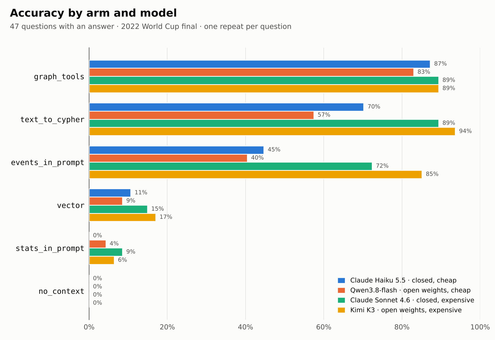
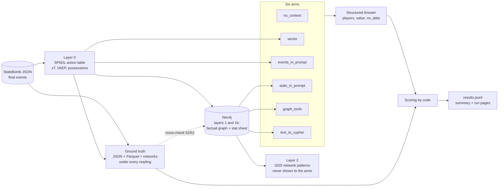

# match-events-qa-benchmark

*English · [Português](README.pt-br.md)*

**Should an LLM read a football match's raw events, retrieve from them, read a
stat sheet, or query a knowledge graph through tools?** This benchmark answers
that with 52 closed questions about the 2022 World Cup final (Argentina vs
France, StatsBomb Open Data). Every answer is computed and graded by code. No
LLM acts as a judge.

<picture>
  <source media="(prefers-color-scheme: dark)" srcset="docs/img/accuracy-dark.png">
  
</picture>

## Key findings

- **Graph tools are the most stable choice.** `graph_tools` scores 83% to 89%
  on all four models, cheap or expensive, closed or open weights.
- **Tools close the price gap.** On the cheap models (Claude Haiku 5.5,
  Qwen3.8-flash), tools beat writing Cypher by 17 to 26 points and reading the
  whole match by 42 to 43 points. With tools, a cheap model gets within 7 to
  11 points of the best score any model reached on any arm.
- **Expensive models can catch up without tools, at a cost.** Kimi K3 and
  Claude Sonnet 4.6 reach 89% to 94% by writing their own Cypher. Kimi K3
  reaches 85% by reading all 2,585 events, but that takes far more time and
  reasoning tokens.
- **Vector RAG and the stat sheet don't fit these questions.** Counts, time
  slices and passing-network questions need every relevant row or a
  computation. 30 similar rows or a full-match stat sheet are not enough, so
  these arms stay under 20%.
- **About half of the models screened failed on tool calling or structured output.**
  The benefit of tools assumes the model can call them reliably.

## How it works



The ground truth never reads Neo4j. It is computed from the raw JSON and
the layer 0 table, under every reasonable reading of each question, and then
compared with the graph. A question stays in the benchmark only if every
reading agrees on its answer.

| Arm | What the model receives |
|---|---|
| `no_context` | only the question (measures what the model answers from memory) |
| `vector` | the 30 event rows most similar to the question (embedding search) |
| `events_in_prompt` | all 2,585 on-ball actions of the match (~78k to ~115k tokens, depending on the model) |
| `stats_in_prompt` | the per-player and per-team stat sheet |
| `graph_tools` | 8 primitive tools over the Neo4j graph: filtered counts, action lists, possessions, passing networks, network metrics (GDS), pass paths |
| `text_to_cypher` | the graph schema and one read-only tool that runs the Cypher the model writes |

| Question group | Questions | Example (questions are sent in Portuguese) |
|---|---|---|
| Search and counting | 11 | "After the goal that made it 2–2 in normal time, how many shots did Argentina take until the end of extra time?" |
| Pass network relations | 20 | "Which France pair exchanged the most passes with each other in the final?" |
| Plays and sequences | 10 | "Which two Argentina players most often took part together in the same plays that reached the final third?" |
| Before and after a game moment | 6 | "After Di María was substituted, which teammate passed the ball to Messi the most?" |
| Control: no answer | 5 | "How many minutes did Messi spend in the attacking half during the final?" |

## Results

Accuracy on the 47 questions with an answer (the other 5 are controls), one
repeat per question, on four models paired by price:

| Arm | Claude Haiku 5.5 | Qwen3.8-flash | Claude Sonnet 4.6 | Kimi K3 |
|---|---|---|---|---|
| `graph_tools` | 41/47 (87%) | 39/47 (83%) | 42/47 (89%) | 42/47 (89%) |
| `text_to_cypher` | 33/47 (70%) | 27/47 (57%) | 42/47 (89%) | 44/47 (94%) |
| `events_in_prompt` | 21/47 (45%) | 19/47 (40%) | 34/47 (72%) | 40/47 (85%) |
| `vector` | 5/47 (11%) | 4/47 (9%) | 7/47 (15%) | 8/47 (17%) |
| `stats_in_prompt` | 0/47 | 2/47 (4%) | 4/47 (9%) | 3/47 (6%) |
| `no_context` | 0/47 | 0/47 | 0/47 | 0/47 |
| **Kind** | closed, cheap | open weights, cheap | closed, expensive | open weights, expensive |
| **Cost of the round** | US$ 1.04 | ~US$ 0.49 | ~US$ 28 (with reruns) | US$ 33.40 |

With one repeat, these are sample numbers with wide confidence intervals
(about ±12 points). The two expensive models combine size and reasoning, and
Sonnet 4.6 ran `events_in_prompt` with a different reasoning effort. The
conditions of each round and the limits of this reading are in
[chapter 7](docs/07-decisions-and-limitations.md).

| Model | Results file | Run page |
|---|---|---|
| Claude Haiku 5.5 | [`claude-haiku-5.5_results.jsonl`](data/benchmark/claude-haiku-5.5_results.jsonl) | [`2026-10-10_01_claude-haiku-5.5.md`](docs/runs/2026-10-10_01_claude-haiku-5.5.md) |
| Qwen3.8-flash | [`qwen3.8-flash_results.jsonl`](data/benchmark/qwen3.8-flash_results.jsonl) | [`2026-10-12_02_qwen3.8-flash.md`](docs/runs/2026-10-12_02_qwen3.8-flash.md) |
| Claude Sonnet 4.6 | [`claude-sonnet-4.6_results.jsonl`](data/benchmark/claude-sonnet-4.6_results.jsonl) | [`2026-10-13_04_claude-sonnet-4.6.md`](docs/runs/2026-10-13_04_claude-sonnet-4.6.md) |
| Kimi K3 | [`kimi-k3_results.jsonl`](data/benchmark/kimi-k3_results.jsonl) | [`2026-10-12_03_kimi-k3.md`](docs/runs/2026-10-12_03_kimi-k3.md) |

Each run page has the setup, the real cost, the results by group, the misses
of each arm and links to the Langfuse traces. The Langfuse project is
private, so the trace links only open for its members. To redraw the chart
from the results files: `pip install -e ".[plot]"` and then
`python scripts/plot_results.py`.

## Quickstart

With Docker and Python 3.11 (the Docker-only path and the details are in
[chapter 6](docs/06-how-to-run.md)):

```bash
cp .env.example .env                       # fill in the LLM and embedding keys
scripts/local_setup.sh                     # environment, Neo4j and data layers; no API cost
source .venv/bin/activate
python scripts/check_ground_truth.py       # ground truth vs graph: must say 52/52
python scripts/run_benchmark.py --sample   # one question per type, a few cents
```

Then run the full benchmark with `python scripts/run_benchmark.py --fresh`.
You can also ask your own questions about the final, which are answered but
not graded:

```bash
python scripts/ask.py --arm graph_tools               # interactive: one question per line
python scripts/ask.py "Quem tocou mais na bola?" --arm graph_tools
python scripts/ask.py --question s03                  # a benchmark question, with its ground truth
```

## Engineering highlights

- **Ground truth independent of the system under test.** The answers come
  from the raw JSON and from pandas and networkx over the Parquet table. A
  cross-check script then answers all 52 questions again through the tools,
  and `scripts/check_cypher.py` answers the 47 with an answer through
  hand-written Cypher.
- **Robustness over readings.** Each question is computed under every
  reasonable reading: pass set, link weight, direction, time cut, third,
  sequence rules and data source. 22 of the 81 questions written were removed
  because their answer depended on the reading. Ties are kept as `accepted`
  answers.
- **Frozen tool contract.** The tools and their descriptions were written
  before the questions that test them. A test stores a hash of the
  definitions, so a change to them shows up.
- **Same setup for every arm.** All arms share one model, one system prompt,
  one structured output type (PydanticAI) and one retry policy. Only the
  data changes.
- **Cost control.** Prompt caching makes the large fixed prompts cheap after
  the first question. The provider is pinned on OpenRouter and fallbacks are
  off, and runs can use your own Bedrock key (BYOK). Provider errors are
  never stored as answers, and `--resume` redoes them.
- **Read-only text-to-Cypher.** The query filter allows reads only and blocks
  procedures and the layer 2 patterns. Each query runs in a read session
  with a row limit and a timeout.

**Stack:** Python 3.11, Neo4j 5 with GDS and APOC, PydanticAI, kloppy,
socceraction (SPADL, xT, VAEP), pandas, networkx, Langfuse, Docker, OpenRouter
and Amazon Bedrock.

## Documentation

The chapters can be read in order, with no prior knowledge. Each one is also
available in Portuguese in [`docs/pt-br/`](docs/pt-br/).

| Chapter | What you learn |
|---|---|
| [1. Overview](docs/01-overview.md) | the benchmark's question, the 6 arms, the 5 question groups and the 4 models |
| [2. From data to graph](docs/02-from-data-to-graph.md) | the path from the raw JSON to the graph database, following Di María's goal |
| [3. Questions and ground truth](docs/03-questions-and-ground-truth.md) | the question file, all 52 questions translated, and how the right answer is computed and checked |
| [4. The six arms](docs/04-the-six-arms.md) | exactly what each arm sends to the model, with real excerpts |
| [5. Scoring and metrics](docs/05-scoring-and-metrics.md) | how each answer is graded and how to read the report |
| [6. How to run](docs/06-how-to-run.md) | step by step from scratch, local or Docker, other models, troubleshooting |
| [7. Decisions and limitations](docs/07-decisions-and-limitations.md) | why each choice was made, the four models and their conditions, data issues, what the benchmark does not say |
| [8. Glossary](docs/08-glossary.md) | every technical term in plain language |
| [9. Data transformations](docs/09-data-transformations.md) | everything that happens to the data, from the raw JSON to what each arm sees |
| [Run log](docs/runs/README.md) | every benchmark run: setup, real cost, results, findings and trace links |

## Repository layout

```text
config/              questions.yaml (the 52 questions), benchmark.yaml (default arms)
data/benchmark/      ground truth, robustness report, results and summaries per model
docs/                English chapters, docs/pt-br/ (Portuguese), docs/runs/ (run log)
scripts/             pipeline, graph build, benchmark runner, checks, reports, ask.py
src/football_graphrag/
  ingestion/         layer 0: StatsBomb -> SPADL -> xT, VAEP, zones, possessions
  graph/             layers 1, 1b and 2 in Neo4j
  benchmark/         arms, tools, text-to-Cypher, ground truth, scoring, reports
  llm/               model providers (OpenRouter, Anthropic, Gemini, Mistral, Bedrock)
tests/               scoring, ground truth, tools, prompts, layers (no LLM calls)
```

The Python package is still named `football_graphrag`, the project's
original working name.

## License and data

The code, the documentation and the results files in this repository are
under the [MIT license](LICENSE).

The match events come from [StatsBomb Open Data](https://github.com/statsbomb/open-data),
which has its own terms, including a requirement to credit StatsBomb when you
publish work built on the data. The raw data is **not** in this repository:
`scripts/download_statsbomb.py` downloads it to `data/raw/`. Anyone who
reuses the code or the results must read and follow those terms.
