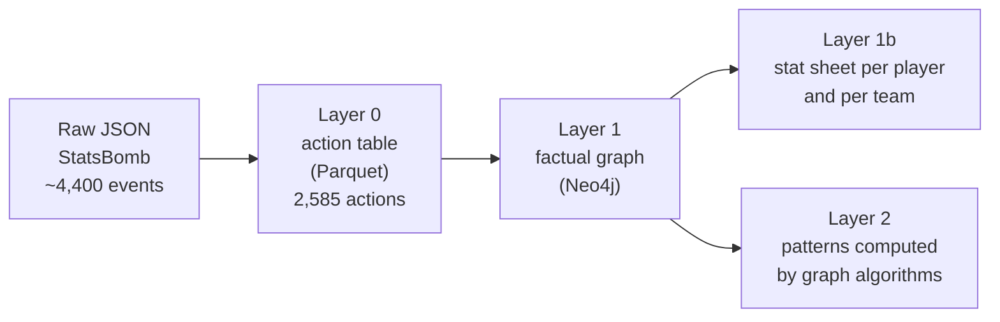

# 2. From the data to the graph: following Di María's goal

This chapter follows one real play from the first format to the last: Ángel
Di María's goal in the 36th minute of the final, after a pass from Mac
Allister. You will see the same play as raw JSON, as a table row and as part
of a graph. By the end it is clear where every number the arms use comes from.

The whole path has four steps, called **layers**:



**No layer uses an LLM.** Everything is deterministic computation: running it
again gives exactly the same result. The LLM only comes in during the
benchmark, as the one answering the questions.

A note on language: the data model was built in Portuguese, and the labels
the models see stay in Portuguese, because changing them would change the
experiment. Action types are values like `passe` (pass), `conducao` (carry),
`finalizacao` (shot), `desarme` (tackle); graph labels are `Jogador` (player),
`Time` (team), `Partida` (match), `REALIZOU` (performed), `PASSOU_PARA`
(passed to). This chapter gives the English meaning next to each one.

---

## Step 0: StatsBomb's raw JSON

StatsBomb publishes match data in
[StatsBomb Open Data](https://github.com/statsbomb/open-data). For each match
there are two files the project uses:

- `events/3869685.json`: the list of events, in order;
- `lineups/3869685.json`: the lineups, with each player's full name and
  nickname.

Di María's goal looks like this in the JSON (trimmed to the main fields):

```json
{
  "period": 1,
  "minute": 35,
  "second": 22,
  "type":   { "name": "Shot" },
  "team":   { "name": "Argentina" },
  "player": { "name": "Ángel Fabián Di María Hernández" },
  "location": [111.8, 32.1],
  "possession": 52,
  "shot": {
    "outcome":   { "name": "Goal" },
    "type":      { "name": "Open Play" },
    "body_part": { "name": "Left Foot" },
    "statsbomb_xg": 0.303
  }
}
```

And Mac Allister's pass, two seconds earlier:

```json
{
  "minute": 35, "second": 20,
  "type":   { "name": "Pass" },
  "player": { "name": "Alexis Mac Allister" },
  "pass": {
    "recipient": { "name": "Ángel Fabián Di María Hernández" },
    "goal_assist": true
  }
}
```

Three details that will matter later:

1. **The player's name is the full registered name**: "Ángel Fabián Di María
   Hernández", not "Di María". That is why scoring the answers has to
   recognize nicknames (chapter 5).
2. **The `minute` field counts elapsed minutes**, starting at 0. The goal came
   in elapsed minute 35, which shows on the broadcast as **36'**.
3. **The JSON is rich but irregular.** Each event type has its own fields
   (`shot`, `pass`, `foul_committed`, `bad_behaviour`...). Counting "how many
   yellow cards" requires knowing that the card can come inside
   `foul_committed` or `bad_behaviour`. It is easy to get wrong.

---

## Layer 0: from events to actions (SPADL)

Layer 0 turns the JSON into a regular table, one row per **on-ball action**,
and writes it to `data/processed/3869685.parquet` (Parquet is a compact table
format, like a more efficient CSV).

### What SPADL is

**SPADL** is a standard format for football actions, created by researchers so
that data from different providers looks the same. It:

- keeps only on-ball actions (pass, carry, shot, tackle, foul...) and drops
  auxiliary events such as "received the ball" and "half started";
- gives every action the same fields: who, team, from where, to where, type,
  result (success or failure), body part;
- flips the pitch so that **every team always attacks from left to right**.
  That way, "high x" always means "close to the opponent's goal". The
  conversion from `kloppy` delivers the home team (Argentina) attacking to the
  right only in odd periods, with sides swapping every period. Layer 0 mirrors
  the start and end coordinates of the actions that would otherwise be
  reversed: the home team's in even periods and the away team's in odd ones. A
  test checks that every action lands in the same place as in the raw JSON
  (which is already from the acting team's point of view) and that every shot
  is in the attacking third.

The ~4,400 events of the final become **2,585 actions**. The conversion is
done by the `socceraction` library, from the JSON as read by `kloppy`.

### The goal sequence in the layer 0 table

These are the five actions that end in the goal (columns trimmed; the column
names and action values are the real ones, in Portuguese):

| action_id | `minuto` (minute) | player | `acao` (action) | `sucesso` (success) | zone start → end | xT added | receiver |
|---|---|---|---|---|---|---|---|
| 706 | 36 | Messi | `passe` (pass) | yes | 41 → 49 | 0.002 | Julián Álvarez |
| 707 | 36 | Julián Álvarez | `conducao` (carry) | yes | 49 → 49 | 0.000 | – |
| 708 | 36 | Julián Álvarez | `passe` | yes | 49 → 74 | 0.012 | Mac Allister |
| 709 | 36 | Mac Allister | `passe` | yes | 74 → 92 | **0.184** | Di María |
| 710 | 36 | Di María | `finalizacao` (shot) | yes (goal) | 92 → 91 | 0.000 | – |

The columns layer 0 adds to SPADL:

- **`acao`, `sucesso`, `minuto`**: football vocabulary. SPADL calls a carry
  `dribble` and a take-on `take_on`, which confuses any reader (an LLM
  included). Here `acao` says `conducao` (carry) or `drible` (take-on),
  `sucesso` is yes or no, and `minuto` is the broadcast minute (36, not 35).
  These rules live in `ingestion/football_semantics.py`, including definitions
  such as "successful tackle".
- **Zones**: the pitch is divided into a grid of **12 columns × 8 rows = 96
  zones**, numbered 0 to 95 (`zone = column × 8 + row`). Column 0 is next to
  the team's own goal and column 11 next to the opponent's. Columns 0–3 are
  the defensive third, 4–7 the middle third and 8–11 the attacking third. Mac
  Allister's pass went from zone 74 (column 9, attack) to zone 92 (column 11,
  inside the box).
- **xT (expected threat)**: how much an action increased the team's chance of
  scoring in the next plays. Each zone has a threat value; moving the ball from
  a weak zone to a strong one adds positive xT. Mac Allister's pass added
  0.184, the most in the sequence, because it put the ball inside the box.
- **VAEP**: another measure of an action's value, which also accounts for the
  risk of conceding. It is computed by a machine learning model.
- **Possession phase (`possession_id`)**: a number grouping consecutive actions
  of the same team with the ball. The five actions above are in phase 132.

xT and VAEP come from models **trained once** on the 16 knockout games of the
2022 World Cup, the final included, and stored in `data/models/`. When training
xT, actions are also put left to right. VAEP expects SPADL's original layout
(home team to the right, away team to the left) and does the flipping itself,
so it receives the actions in that layout.

### An important difference between the JSON and layer 0

The conversion to SPADL is not perfect, and the benchmark found two cases:

- **Attempted passes**: SPADL drops some passes of the JSON. Enzo Fernandez
  has 94 passes in the JSON and 92 in layer 0. **Completed** passes agree (79
  in both).
- **Goalkeeper saves**: the JSON has 7 saves by Lloris ("Shot Saved") and layer
  0 has 8, because a goalkeeper rush to clear the ball ("Keeper Sweeper
  Clear", minute 107) was classified as a save.

That is why no question in the benchmark depends on these two numbers. The
project's rule was not to touch layers 0 to 2 at this stage, so the problem
was recorded, not fixed (chapter 7).

---

## Layer 1: the factual graph (Neo4j)

### What a graph is, and why use one

A **graph** stores data as **nodes** (things) and **edges** (links between
things). Instead of a table with one row per pass, the graph stores "Mac
Allister → passed to → Di María" as a link between two players.

The advantage shows in questions about **relations**: "who passes to whom",
"who the ball flows through", "which trios of players repeat". In a table,
this requires joining the table with itself several times. In a graph, it is
following the arrows.

The database is **Neo4j**, queried with the **Cypher** language. A Cypher
query looks like a drawing of the path:

```cypher
MATCH (a:Jogador)-[p:PASSOU_PARA]->(b:Jogador {nome: 'Ángel Fabián Di María Hernández'})
RETURN a.nome, count(p)
```

It reads: "find players `a` who passed to Di María and count the passes".

### What is in the graph

**Nodes** (the "things"):

| Node | What it represents | In the final |
|---|---|---|
| `Partida` (match) | the game | 1 |
| `Time` (team) | Argentina, France | 2 |
| `Jogador` (player) | each player who touched the ball | 34 |
| `Zona` (zone) | each of the 96 zones of the pitch | 96 |
| `FaseDePosse` (possession phase) | each possession sequence of a team | 537 |

**Edges** (the "links"):

| Edge | Links | Meaning | In the final |
|---|---|---|---|
| `REALIZOU` (performed) | Player → Match | **every action**, with all layer 0 fields (action, success, minute, goal, card...) | 2,585 |
| `PASSOU_PARA` (passed to) | Player → Player | every **completed** pass with a known receiver | 989 |
| `DEU_ASSISTENCIA` (assisted) | Player → Player | the pass that led to a goal | 2 |
| `FINALIZOU` (shot) | Player → Match | every shot | 30 |
| `PRESSIONOU` (pressed) | Player → Player | every press on an opponent on the ball | 301 |
| `MEMBRO_DE` (member of) | Player → Team | which team the player belongs to | 34 |
| `ATUOU_EM` (acted in) | Player → Zone | which zones the player acted in, and how often | 1,039 |
| `PARTICIPOU_DE` (took part in) | Player → Possession phase | which possessions the player took part in | 1,300 |
| `PROGREDIU_PARA` (progressed to) | Zone → Zone | the ball moved forward from one zone to another | 1,018 |

### The goal sequence in the graph

Mac Allister's pass became this edge (main properties):

```
(Alexis Mac Allister) -[PASSOU_PARA {minuto: 36, zona_origem: 74, zona_destino: 92,
                                     xt_gerado: 0.184, progressivo: true,
                                     fase_posse_id: "3869685:132"}]-> (Ángel Fabián Di María Hernández)
```

And also a `DEU_ASSISTENCIA` edge from Mac Allister to Di María, minute 36. The
shot became a `REALIZOU` edge from Di María with `acao: finalizacao`, `gol:
true`, `desfecho: gol` (outcome: goal), `terco: ataque` (third: attacking),
`corredor: centro` (corridor: center).

**Every piece of information in the graph came from a layer 0 row.** The graph
computes nothing new; it reorganizes the table into links.

---

## Layer 1b: the precomputed stat sheet

Questions like "who made the most successful tackles?" are simple to state but
hide a decision: **attempted** or **successful** tackles? Enzo Fernandez
attempted 9 and won 5. A model that counts the wrong thing answers 9.

Layer 1b settles this by doing the counts **once, in code**, and storing the
result as `EstatisticaJogador` nodes (one per player) and `EstatisticaTime`
nodes (one per team). Each field has a name that says exactly what it counts:
`desarmes_tentados` (tackles attempted) and `desarmes_certos` (tackles won)
are separate fields.

Di María's stat sheet, for example:

| field | value | meaning |
|---|---|---|
| `toques` | 76 | on-ball actions of any type |
| `passes_certos` / `passes_tentados` | 25 / 29 | completed / attempted passes |
| `dribles_certos` / `dribles_tentados` | 5 / 8 | successful / attempted take-ons |
| `finalizacoes` | 2 | shots |
| `gols` | 1 | goals |
| `assistencias` | 0 | assists |

The counts are done **by Neo4j itself, on top of the `REALIZOU` edges**. That
way the stat sheet never disagrees with a count done by hand on the graph. The
team sheet also has possession (measured by **time** on the ball, not number
of touches), PPDA (pressing intensity) and *field tilt* (territorial
dominance). These terms are in the [glossary](08-glossary.md).

**This stat sheet is exactly what the `stats_in_prompt` arm receives.**
`graph_tools` does not read it: its tools count directly over the action and
pass edges, the same ones the sheet is counted from.

---

## Layer 2: patterns computed by graph algorithms

Layer 2 runs algorithms over the graph with Neo4j's **GDS** (Graph Data
Science) library and stores the results as `PadraoTatico` (tactical pattern)
nodes. Two of these patterns show up in the benchmark:

- **`pivo_estrutural`** (structural pivot): the player through whom the most
  passing routes between teammates go, measured by **betweenness centrality**
  (explained in chapter 3). For Argentina, Otamendi; for France, Koundé.
- **`terceiro_homem`** (third man): combinations of three players (A passes to
  B, B passes to C) that repeat and move the ball forward.

**In the benchmark, layer 2 has a single role: checking the ground truth.** No
arm reads the `PadraoTatico` nodes, because that would hand over the answer.
When the `graph_tools` arm needs a structural computation, the tool runs the
algorithm on the spot, over the same passing network. Chapter 3 shows how the
ground truth is checked against layer 2.

---

## Summary: where each number comes from

| What the arm uses | Source |
|---|---|
| event table (`events_in_prompt`, `vector`) | layer 0 (Parquet) |
| stat sheet (`stats_in_prompt`) | layer 1b (Neo4j) |
| tools (`graph_tools`) | layers 1 and 1b (Neo4j) + GDS algorithms run on the spot |
| ground truth | raw JSON + layer 0, **never Neo4j** (chapter 3) |
